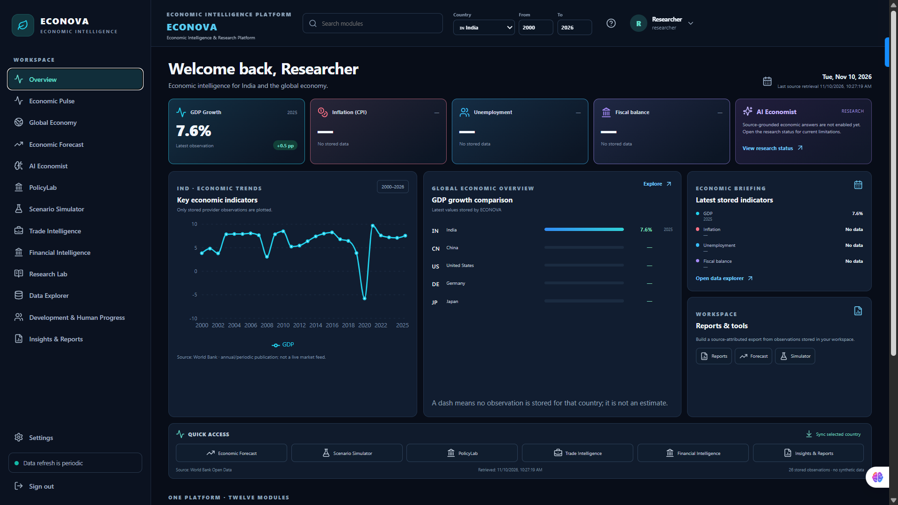
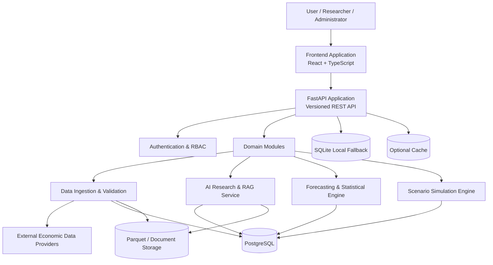
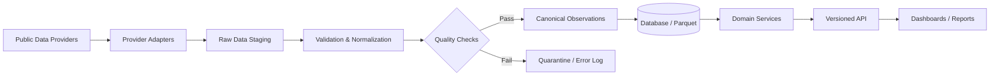
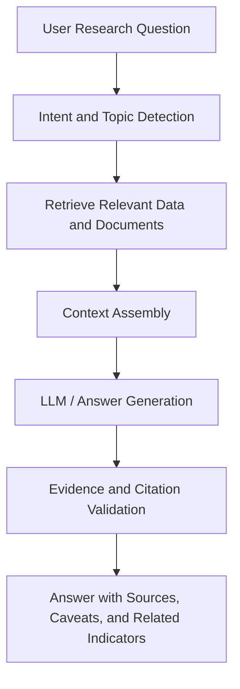

<div align="center">

# ECONOVA

### Economic Intelligence & Research Platform

**Understand the economy. Explore the evidence. Model what comes next.**

A unified economic intelligence workspace for exploring Indian and global economic indicators, comparing countries, studying policy, building forecasts, and conducting evidence-led research.

[Dashboard Preview](#dashboard-preview) · [Platform Architecture](#platform-architecture) · [Modules](#platform-modules) · [Getting Started](#getting-started) · [Data & Research Integrity](#data--research-integrity)

</div>

---

## Table of Contents

- [Overview](#overview)
- [Dashboard Preview](#dashboard-preview)
- [Platform Modules](#platform-modules)
- [Platform Architecture](#platform-architecture)
- [Technology Stack](#technology-stack)
- [Repository Structure](#repository-structure)
- [Data Architecture and Sources](#data-architecture-and-sources)
- [AI Economist and Research Workflow](#ai-economist-and-research-workflow)
- [Forecasting and Scenario Simulation](#forecasting-and-scenario-simulation)
- [Security and Administration](#security-and-administration)
- [Getting Started](#getting-started)
- [Configuration](#configuration)
- [API Overview](#api-overview)
- [Testing and Quality](#testing-and-quality)
- [Deployment](#deployment)
- [Roadmap](#roadmap)
- [Data & Research Integrity](#data--research-integrity)
- [Contributing](#contributing)
- [License](#license)

---

## Overview

**ECONOVA** is designed as a research-oriented economic intelligence platform covering both the **Indian economy and the global economy**. It brings economic monitoring, country comparisons, forecasting, policy research, scenario analysis, trade intelligence, financial indicators, and human-development metrics into one consistent workspace.

Rather than presenting disconnected charts, ECONOVA is designed to connect:

- **Data** — sourced economic observations with dates, units, frequency, and provenance.
- **Analysis** — historical trends, country comparisons, statistical methods, and indicator relationships.
- **AI-assisted research** — questions answered with retrieved evidence and traceable sources.
- **Forecasting** — reproducible model runs, evaluation metrics, and uncertainty intervals.
- **Policy and scenarios** — structured analysis of policy documents and clearly labelled hypothetical simulations.
- **Reporting** — saved analyses and source-attributed reports.

### Product principles

1. **Evidence before interpretation:** show the source, period, unit, and retrieval status behind a figure.
2. **No fabricated observations:** missing data is shown as unavailable, not silently estimated.
3. **Transparent uncertainty:** forecasts and simulations include assumptions and limitations.
4. **Modular, integrated experience:** twelve functional areas share one application shell and common data services.
5. **Local-first development:** the core application should remain usable locally without requiring a paid cloud service.
6. **Responsible AI:** distinguish sourced facts, calculated results, interpretations, and hypotheses.

> **Project status:** This README documents the intended product architecture and dashboard direction. The screenshot is a UI preview, not proof that every module, integration, or metric is already implemented. Update the implementation status and setup commands to match the current repository before publishing a production release.

---

## Dashboard Preview

The following screenshot was provided as the visual reference for the ECONOVA workspace.

<p align="center">
  
</p>

*The dashboard uses a premium dark research-terminal style, with module navigation, economic KPI cards, indicator trends, global comparisons, briefings, and research tools. Values visible in a design preview should be treated as illustrative unless independently verified against a cited data source.*

### Dashboard layout

- **Left navigation:** Overview and the twelve ECONOVA modules.
- **Global toolbar:** module search, country selection, date range, help, and user profile.
- **KPI row:** GDP growth, CPI inflation, unemployment, and fiscal balance where observations are available.
- **Economic trends:** time-series charts with date range and source context.
- **Global overview:** country-level comparisons with unavailable values clearly indicated.
- **Economic briefing:** latest stored observations and their periods.
- **Workspace tools:** reports, forecasting, and scenario analysis shortcuts.

---

## Platform Modules

ECONOVA is organized into twelve connected modules. Each module should have its own route, page-level state, filters, visualizations, and API integration while reusing shared components and services.

| # | Module | Suggested route | Purpose |
|---:|---|---|---|
| 1 | **ECONOVA PULSE** | `/pulse` | Monitor macroeconomic indicators such as GDP, inflation, employment, industrial production, interest rates, reserves, and fiscal balance. |
| 2 | **ECONOVA GLOBAL** | `/global` | Explore countries and regions, compare up to five economies, and examine GDP, inflation, unemployment, debt, and development indicators. |
| 3 | **ECONOVA FORECAST** | `/forecast` | Run and compare time-series and machine-learning forecasts with backtesting, evaluation metrics, and uncertainty intervals. |
| 4 | **ECONOVA AI ECONOMIST** | `/ai-economist` | Ask economics questions, include selected-country observations, and analyze uploaded files with citations. |
  | 5 | **ECONOVA POLICYLAB** | `/policylab` | Browse Indian government and RBI policies, latest official macroeconomic statistics, policy goals, implementation measures, trade-offs, and source links. Policy details appear on hover or keyboard focus. |
| 6 | **ECONOVA SIMULATOR** | `/simulator` | Model hypothetical shocks such as oil-price changes, interest-rate shifts, currency depreciation, and spending changes. |
| 7 | **ECONOVA TRADE** | `/trade` | Inspect the latest released monthly goods exports/imports by partner with interactive bar, pie and box plots plus a walk-forward trade-balance direction confusion matrix. Data is release-based, not streaming. |
| 8 | **ECONOVA FINANCE** | `/finance` | View one-minute/five-minute intraday bars with 30-second refresh, daily country-index history, OHLC and volume, technical patterns and model-based ranges. The free chart provider does not guarantee exchange-grade real-time quotes. |
  | 9 | **ECONOVA RESEARCH LAB** | `/research-lab` (`/research` alias) | Browse source-linked economics studies and Economic Survey evidence, including findings, methods, limitations, and measurable goals for growth, jobs, infrastructure, skills, and productivity. |
| 10 | **ECONOVA DATA EXPLORER** | `/data-explorer` | Search the indicator catalogue, inspect datasets, filter by country and period, review metadata, and export data. |
| 11 | **ECONOVA DEVELOPMENT & HUMAN PROGRESS** | `/development` | Explore poverty, inequality, education, healthcare, labour participation, human development, and sustainable development. |
| 12 | **ECONOVA INSIGHTS & REPORTS** | `/insights` | Create daily or periodic briefings, country reports, policy reports, forecast summaries, and custom exports. |

### Shared workspace

The modules share a consistent application shell:

- Sidebar navigation and active-module state
- Global search and country/date filters
- Reusable KPI cards, charts, tables, and source badges
- Notifications, saved analyses, and user preferences
- Contextual AI research panel
- Data freshness and system-status indicators
- Responsive desktop, tablet, and mobile layouts

---

## Platform Architecture

### 1. High-level architecture



### 2. Architectural layers

| Layer | Responsibility | Main components |
|---|---|---|
| Presentation | User interface, navigation, filters, visualizations, responsive layout | React, TypeScript, Vite, Tailwind CSS |
| API | Request validation, routing, serialization, versioning, error handling | FastAPI, Pydantic |
| Identity & access | Login, session/token handling, role-based permissions | Secure password hashing, authentication middleware, RBAC |
| Domain services | Economic indicators, country data, trade, finance, policy, reports | Python service modules |
| Data ingestion | Fetch, normalize, validate, deduplicate, and store observations | Provider adapters, Pandas, scheduled jobs |
| Persistence | Users, metadata, observations, model runs, reports, audit events | PostgreSQL; SQLite for local development |
| Analytical engine | Statistical analysis, forecasts, backtesting, simulations | NumPy, Pandas, Statsmodels, Scikit-learn |
| AI research | Retrieval, document chunking, embeddings, grounded answers, citations | RAG pipeline, vector index such as FAISS |
| File and dataset storage | Research documents, exports, and historical datasets | Local/object storage abstraction, Parquet |
| Operations | Logs, health checks, tests, deployment configuration | Pytest, structured logging, Docker where configured |

### 3. Request and data flow

1. A user selects a module, country, indicator, and date range in the frontend.
2. The frontend calls the relevant `/api/v1/...` endpoint.
3. FastAPI validates parameters and checks access permissions.
4. The domain service requests normalized observations from the data layer.
5. The data layer returns stored records with source and time metadata, or invokes an approved provider adapter when ingestion is required.
6. The service performs calculations or analytical transformations.
7. The API returns structured results, metadata, and clear empty/error states.
8. The frontend renders charts, tables, source attribution, and data freshness information.

### 4. Suggested backend service boundaries

- `auth`: identity, sessions/tokens, role checks
- `users`: user profiles and preferences
- `indicators`: indicator definitions, units, frequencies, and metadata
- `countries`: country and region reference data
- `ingestion`: provider adapters, sync jobs, validation, and provenance
- `pulse`: macroeconomic dashboard queries
- `global_economy`: country profiles and comparisons
- `forecasting`: model training, inference, backtesting, and metrics
- `ai_economist`: retrieval and grounded question answering
- `policy`: policy documents and structured analysis
- `simulator`: scenario inputs, assumptions, and results
- `trade`: trade observations and partner analysis
- `finance`: monetary and financial indicators
- `research`: document processing, notes, and citations
- `catalogue`: dataset discovery and exports
- `development`: human-development indicators
- `reports`: report generation and export
- `admin`: user, system, ingestion, and audit management

### 5. Suggested frontend boundaries

- `app`: application bootstrap, routes, providers
- `components/layout`: sidebar, top navigation, workspace, status bar
- `components/common`: buttons, cards, badges, loading and error states
- `components/charts`: time-series, comparison, distribution, and map visualizations
- `components/tables`: indicator, ranking, and observation tables
- `components/filters`: country, indicator, date, and frequency controls
- `modules`: one page and supporting components for each ECONOVA module
- `services`: typed API clients
- `store`: shared UI and user preference state
- `hooks`: reusable data and interaction hooks
- `types` and `schemas`: API types and runtime validation
- `utils` and `constants`: formatting, date, units, and shared configuration

---

## Technology Stack

The following is the recommended architecture stack. Check the actual dependency manifests in this repository for the versions and packages currently installed.

| Area | Recommended technology | Use |
|---|---|---|
| Frontend | React, TypeScript, Vite | Component-based web application |
| Styling | Tailwind CSS | Responsive design system |
| Routing | React Router | Module navigation |
| Server state | TanStack Query | API caching and request lifecycle |
| Client state | Zustand | Shared UI preferences and state |
| Charts | Recharts; Python Plotly, Matplotlib and Seaborn | Interactive application charts, financial candles, and statistical risk diagnostics |
| Forms | React Hook Form, Zod | Form state and validation |
| Backend | Python, FastAPI | REST API and domain services |
| Validation | Pydantic | Request and response schemas |
| ORM and migrations | SQLAlchemy, Alembic | Relational persistence |
| Primary database | PostgreSQL | Persistent application data |
| Local fallback | SQLite | Local development without a database server |
| Data analysis | Pandas, NumPy | Data cleaning and numerical analysis |
| Econometrics | Statsmodels | Time-series and statistical models |
| Machine learning | Scikit-learn | Baseline and ML forecasting |
| Optional deep learning | TensorFlow | Experimental sequence models |
| Document retrieval | FAISS and embeddings | Research retrieval / RAG |
| Dataset format | Parquet | Efficient analytical storage |
| Testing | Pytest; frontend test tooling | Automated quality checks |
| Packaging | Docker / Docker Compose | Reproducible environments where configured |

---

## Repository Structure

A suggested monorepo structure for the complete platform is shown below. Preserve the existing repository layout where it already serves the same purpose; do not duplicate or replace working code just to match this example.

```text
ECONOVA/
├── README.md
├── .env.example
├── .gitignore
├── docker-compose.yml
│
├── frontend/
│   ├── public/
│   │   ├── favicon.ico
│   │   └── assets/
│   ├── src/
│   │   ├── app/
│   │   ├── assets/
│   │   ├── components/
│   │   │   ├── common/
│   │   │   ├── layout/
│   │   │   ├── navigation/
│   │   │   ├── charts/
│   │   │   ├── tables/
│   │   │   └── filters/
│   │   ├── modules/
│   │   │   ├── overview/
│   │   │   ├── pulse/
│   │   │   ├── global/
│   │   │   ├── forecast/
│   │   │   ├── ai-economist/
│   │   │   ├── policylab/
│   │   │   ├── simulator/
│   │   │   ├── trade/
│   │   │   ├── finance/
│   │   │   ├── research/
│   │   │   ├── data-explorer/
│   │   │   ├── development/
│   │   │   └── insights/
│   │   ├── hooks/
│   │   ├── services/
│   │   ├── store/
│   │   ├── types/
│   │   ├── schemas/
│   │   ├── utils/
│   │   └── styles/
│   ├── package.json
│   └── vite.config.ts
│
├── backend/
│   ├── app/
│   │   ├── main.py
│   │   ├── core/
│   │   ├── api/
│   │   │   └── v1/
│   │   ├── models/
│   │   ├── schemas/
│   │   ├── repositories/
│   │   ├── services/
│   │   ├── modules/
│   │   ├── ingestion/
│   │   ├── analytics/
│   │   ├── forecasting/
│   │   ├── ai/
│   │   ├── simulation/
│   │   ├── security/
│   │   └── utils/
│   ├── migrations/
│   ├── tests/
│   └── requirements.txt
│
├── data/
│   ├── raw/
│   ├── processed/
│   ├── reference/
│   └── README.md
│
├── research/
│   ├── documents/
│   ├── notebooks/
│   └── methodology/
│
├── scripts/
│   ├── seed_database.py
│   └── run_ingestion.py
│
└── docs/
    ├── architecture/
    ├── api/
    ├── data-dictionary/
    └── screenshots/
```

---

## Data Architecture and Sources

ECONOVA should use provider adapters so that each source can be updated or replaced without coupling the frontend to a provider-specific API.

### Candidate public data sources

| Provider | Potential coverage | Integration considerations |
|---|---|---|
| World Bank Open Data | GDP, population, poverty, development, education, health, and other country indicators | Indicator codes, annual frequency, revisions, and attribution |
| Reserve Bank of India (RBI) | Indian monetary, banking, financial, and macroeconomic statistics | Use official publications and documented access methods |
| Ministry of Statistics and Programme Implementation (MoSPI) | Indian national accounts, CPI, IIP, and official statistics | Publication calendar and revised estimates |
| International Monetary Fund (IMF) | International macroeconomic and financial datasets | Dataset definitions, release cycles, and licensing |
| OECD | Country and policy statistics | Coverage varies by indicator and country |
| UN Comtrade | Merchandise trade flows by reporter, partner, and commodity | Classification, units, reporting period, and API terms |

### Active overview data feeds

The overview fetches missing GDP growth, consumer inflation, and unemployment observations from World Bank Open Data. Fiscal balance comes from the OECD Economic Outlook (`NLGQ`, general-government net lending as a percentage of GDP) through the OECD SDMX API. The dashboard uses data only through the last completed year, labels the fiscal value as an estimate, and excludes forecast years. These sources publish periodically, so the figures are not live market data.

### Financial market data and analytics

Financial Intelligence offers daily open/high/low/close/volume history for selected national indices, including NIFTY 50, SENSEX, NIFTY BANK, S&P 500, NASDAQ Composite, Dow Jones, Nikkei 225, FTSE 100, DAX, and SSE Composite. It retrieves daily history from Yahoo Finance's chart feed, caches each index/range for five minutes, and shows the retrieval time and source link. The feed can be delayed or unavailable and is not licensed exchange-grade real-time data.

The dashboard calculates moving averages, RSI, MACD, recent support/resistance zones, and realized volatility from returned prices. Its 5/20/60-session closing-level ranges use recent average log returns and volatility; the displayed bands are statistical scenarios, not reliable predictions, guaranteed highs/lows, or trading advice. An interactive Plotly candlestick chart and Matplotlib/Seaborn return and volatility diagnostics are rendered on demand. No synthetic market prices are substituted when a provider request fails.

### Canonical observation model

A normalized observation should retain enough metadata to be interpreted and reproduced.

```json
{
  "country_code": "IND",
  "indicator_code": "GDP_GROWTH",
  "indicator_name": "GDP growth (annual %)",
  "value": 0.0,
  "unit": "percent",
  "frequency": "annual",
  "observation_period": "YYYY",
  "source": "Provider name",
  "source_url": "https://example.com/dataset",
  "retrieved_at": "ISO-8601 timestamp",
  "published_at": null,
  "revision_status": "unverified"
}
```

*This JSON is a schema illustration, not an actual ECONOVA observation.*

### Data ingestion lifecycle



Recommended validation checks:

- Required fields and valid country/indicator identifiers
- Numeric parsing and expected units
- Duplicate observations and conflicting provider records
- Valid observation periods and frequency consistency
- Plausibility checks without silently altering source values
- Missing-value handling and revision tracking
- Provider attribution and retrieval timestamp

---

## AI Economist and Research Workflow

The AI Economist uses the configured Gemini model for economics-only conversational answers. It receives the selected country's latest stored overview indicators and any attached file summaries; it does not claim those periodic observations are live data. `GEMINI_API_KEY` must be configured in the backend environment or deployment secrets for conversational answers.

The upload endpoint accepts CSV, TSV, XLS/XLSX, JSON/JSONL, PDF, DOCX, PPTX, TXT, Markdown, HTML, and XML files up to 15 MB each. Tabular files receive local descriptive statistics and sample/group summaries. Text is extracted from supported documents. Scanned PDFs, password-protected PDFs, and unsupported binary formats are rejected with an explanation. Raw files are not retained; extracted summaries are stored for up to 24 hours and can be deleted from the AI Economist page. Attached text is sent to Gemini only when the visitor submits a question.

Public usage is limited to 20 AI requests per minute and 10 uploads per hour per client address per backend process. For a multi-worker production deployment, put a shared rate limiter in front of the API.

The active endpoints are `GET /api/v1/research/status`, `POST /api/v1/research/uploads`, `DELETE /api/v1/research/uploads/{upload_id}`, and `POST /api/v1/research/ask`.

### Grounded question-answering pipeline



A response should distinguish:

- **Sourced fact:** directly supported by a cited provider or document.
- **Calculated result:** derived from identified observations using a stated method.
- **Interpretation:** an analytical explanation based on the evidence.
- **Hypothesis:** a possible explanation that needs further testing.

Example research question:

> Why is the Indian rupee depreciating, and what are the possible economic consequences?

A high-quality response should identify the period being discussed, retrieve relevant exchange-rate and macroeconomic evidence, explain plausible drivers, cite sources, and state uncertainty. It should not invent current values or claim causality from correlation alone.

### Research document workflow

1. Upload a permitted PDF or document.
2. Extract text and preserve document metadata.
3. Split content into traceable chunks.
4. Create embeddings and index them for retrieval.
5. Retrieve relevant passages for a question.
6. Generate a response grounded in those passages.
7. Display document title, page or section reference, and source metadata.

---

## Forecasting and Scenario Simulation

### Forecasting workflow

Potential methods include:

- Naive and seasonal-naive baselines
- Exponential smoothing
- ARIMA and SARIMA
- VAR and VECM where assumptions and data permit
- Random Forest and gradient-boosting models
- Experimental LSTM models where adequate data is available

Each forecast run should record:

- Target indicator, country, frequency, and training period
- Data source and dataset version
- Model name, parameters, and software version
- Train/test split and validation method
- Forecast horizon and prediction intervals
- MAE, RMSE, MAPE (where appropriate), and baseline comparison
- Run timestamp and limitations

Use chronological validation and avoid random shuffling of time-series observations. Forecasts are estimates with uncertainty, not guaranteed outcomes.

### Scenario simulation

The simulator can support hypothetical changes such as:

- Crude oil price shocks
- Policy interest-rate changes
- Government expenditure changes
- Currency depreciation
- Export declines or import-cost increases
- Combined macroeconomic shocks

A scenario result should show the baseline, changed assumptions, model or calculation method, estimated effects, sensitivity, and limitations. It must be labelled as a **hypothetical scenario**, not a forecast or official projection.

---

## Security and Administration

ECONOVA includes a protected administration area for authorized platform management.

### Administrator profile

- **Display name:** Atharav
- **Role:** Super Administrator

The initial administrator should be provisioned through a secure setup process or environment configuration. Never commit credentials, password hashes, API keys, or secret tokens to the repository.

### Administration capabilities

- User management and role assignment
- Module and feature configuration
- Data-provider and ingestion monitoring
- AI and retrieval configuration
- Forecast model registry and run monitoring
- Research-document and report management
- API health, application logs, and audit events
- Security settings and platform configuration

### Security baseline

- Hash passwords using a modern password-hashing algorithm.
- Enforce authorization on the backend for every protected operation.
- Prevent users from granting themselves elevated roles.
- Validate inputs and outputs; apply upload type and size restrictions.
- Keep secrets in environment variables or a secret manager.
- Configure CORS narrowly for trusted frontend origins.
- Use HTTPS in deployed environments.
- Avoid logging passwords, tokens, or sensitive document content.
- Record security-relevant administrative actions.
- Apply rate limits and safe error handling to authentication and AI endpoints.

---

## Getting Started

The repository includes a React + Vite frontend and a FastAPI backend. For local development, run each in its own terminal. The production Docker image builds the frontend and serves it from the backend on port 8000.

### Prerequisites

- Git
- Node.js LTS and npm
- Python 3.11–3.13
- Optional: PostgreSQL
- Optional: Docker and Docker Compose

### 1. Clone the repository

```bash
git clone https://github.com/<YOUR-USERNAME>/<YOUR-REPOSITORY>.git
cd ECONOVA
```

Replace the GitHub URL with the actual repository URL.

### 2. Configure environment variables

```bash
cp .env.example .env
```

On Windows PowerShell:

```powershell
Copy-Item .env.example .env
```

Set only the values required by the local application. Do not commit `.env`.

### 3. Build the frontend

```bash
cd frontend
npm ci
npm run build
cd ..
```

### 4. Start the backend

Create a virtual environment, install the backend dependencies, and start the API from the repository root:

```powershell
py -3.13 -m venv .venv
.venv\Scripts\python.exe -m pip install -r backend\requirements.txt
.venv\Scripts\python.exe -m uvicorn app.main:app --app-dir backend --reload --host 127.0.0.1 --port 8000
```

On macOS or Linux, use `python3` and `.venv/bin/` in place of the Windows launcher and paths above.

With the frontend built, open `http://127.0.0.1:8000/`. The same server provides the API and the application interface.

If configured, interactive API documentation is available at:

- `http://127.0.0.1:8000/docs`
- `http://127.0.0.1:8000/redoc`

### 5. Run the frontend in development mode

In another terminal, start Vite for hot reload:

```bash
cd frontend
npm ci
npm run dev
```

Open `http://127.0.0.1:5173/`. Vite proxies `/api` requests to the backend on port 8000. SQLite tables are created automatically for local development.

---

## Configuration

Keep a safe `.env.example` in the repository and store real credentials only in the local `.env` file or deployment secret settings.

The backend reads these settings from the environment or a root `.env` file:

```dotenv
DATABASE_URL=sqlite:///./econova.db
SECRET_KEY=
FRONTEND_ORIGIN=http://localhost:5173
GEMINI_API_KEY=
GEMINI_MODEL=gemini-3.5-flash-lite
PROVIDER_HTTP_LOCAL_ADDRESS=0.0.0.0
VITE_API_URL=/api/v1
```

`PROVIDER_HTTP_LOCAL_ADDRESS` defaults to IPv4 to avoid unreachable IPv6 routes on some hosts. Set it to `::` for an IPv6-only deployment.

For Docker Compose, also set `POSTGRES_PASSWORD` and a unique `SECRET_KEY` of at least 32 characters in `.env`. Compose uses PostgreSQL and persistent storage. Never expose backend secrets through `VITE_*` variables or commit real keys.

---

## API Overview

Suggested versioned API surface:

| Method | Endpoint | Purpose |
|---|---|---|
| `GET` | `/api/v1/overview` | Overview KPIs and dashboard summary |
| `GET` | `/api/v1/pulse/indicators` | Macroeconomic indicator observations |
| `GET` | `/api/v1/global/countries` | Country catalogue |
| `GET` | `/api/v1/global/compare` | Compare selected economies |
| `POST` | `/api/v1/forecast/run` | Execute a forecast run |
| `POST` | `/api/v1/ai/query` | Submit an evidence-grounded research question |
| `GET` | `/api/v1/policy/documents` | Search policy documents |
| `POST` | `/api/v1/simulator/run` | Run a hypothetical scenario |
| `GET` | `/api/v1/trade/observations` | Trade data and partner analysis |
| `GET` | `/api/v1/trade/overview?country=IND` | Latest released trade totals, partner rows and held-out direction backtest |
| `GET` | `/api/v1/trade/charts/{chart}?country=IND&flow=X` | Interactive Plotly bar, pie, box and confusion-matrix charts |
| `GET` | `/api/v1/finance/markets/{asset_id}?range=1d` | Intraday index bars, technical analysis and approximate statistical range |
| `GET` | `/api/v1/finance/indicators` | Monetary and financial indicators |
| `POST` | `/api/v1/research/documents` | Add a research document |
| `GET` | `/api/v1/data/catalogue` | Search available datasets and indicators |
| `GET` | `/api/v1/development/indicators` | Human-development observations |
| `POST` | `/api/v1/reports/generate` | Generate a source-attributed report |

This table describes a proposed API contract. An endpoint should be considered available only when it exists and is tested in the running backend.

---

## Testing and Quality

Recommended quality gates:

### Backend

```bash
pytest
```

Test API validation, authorization, provider adapters, data normalization, calculations, model evaluation, and error handling.

### Frontend

Use the scripts defined in `frontend/package.json`, for example:

```bash
npm run lint
npm run build
```

### End-to-end checks

- All module routes load and handle refresh/deep links.
- Filters update the correct data query.
- Loading, empty, stale, partial, and error states are visible.
- Charts show units, time periods, and source context.
- Missing observations are not displayed as zero.
- Exports match the selected filters and include source metadata.
- Unauthorized users cannot access administrator actions.
- Layout remains usable on desktop, tablet, and mobile.

---

## Deployment

The included Dockerfile builds the Vite frontend and packages it with the FastAPI service. Docker Compose runs that service with PostgreSQL and a persistent database volume. Set `POSTGRES_PASSWORD` and a unique `SECRET_KEY` (at least 32 characters) in `.env`, then run:

```bash
docker compose up --build -d
```

Open `http://localhost:8000/`; check `http://localhost:8000/health` for service and database readiness, and `/docs` for the API documentation. Configure `FRONTEND_ORIGIN` for the deployment domain before exposing a separately hosted frontend. The Compose database volume persists data across container restarts; configure backups for production.

### Free-tier deployment considerations

- Confirm whether a provider requires a payment card or billing activation before choosing it.
- Free services may sleep, have quotas, or impose CPU, memory, bandwidth, and storage limits.
- Ephemeral filesystems are not suitable for persistent uploads or a production database.
- Do not assume a free hosting tier is suitable for continuous ingestion or heavy model training.
- Keep local development functional if a hosted provider is unavailable.

---

## Roadmap

The following is a suggested implementation sequence, not a claim that every item is already complete.

- [ ] Repository audit and environment setup
- [ ] Shared application shell and responsive navigation
- [ ] Authentication, user roles, and administrator provisioning
- [ ] Canonical country, indicator, and observation data models
- [ ] Provider adapters and validated ingestion pipeline
- [ ] ECONOVA PULSE and GLOBAL
- [ ] ECONOVA DATA EXPLORER
- [ ] ECONOVA FORECAST and model evaluation
- [ ] ECONOVA SIMULATOR
- [ ] ECONOVA AI ECONOMIST and source-grounded RAG
  - [x] PolicyLab government policy tracker and official statistics dashboard
- [ ] TRADE and FINANCE
  - [x] Research Lab source-linked research library and economic goals agenda
- [ ] DEVELOPMENT & HUMAN PROGRESS
- [ ] INSIGHTS & REPORTS
- [ ] Audit logging, monitoring, and security review
- [ ] Automated tests and deployment documentation

---

## Data & Research Integrity

ECONOVA is an economic research and intelligence tool. It is not a substitute for official statistical releases, professional economic advice, or investment advice.

- Always verify important figures against their original provider.
- Display the observation period separately from the retrieval date.
- Preserve provider definitions, units, frequency, and revision status.
- Do not describe periodic data as real-time.
- Do not treat missing values as zero or as estimates.
- Label forecasts, model outputs, and simulations clearly.
- Document assumptions, methodology, and known limitations.
- Cite sources for AI-generated research and make unsupported claims visible.

---

## Contributing

Contributions, bug reports, and architecture discussions are welcome.

1. Fork the repository.
2. Create a focused branch: `git checkout -b feature/your-feature`.
3. Make the change and add or update tests.
4. Run relevant lint, test, and build commands.
5. Open a pull request describing the change, design decisions, and validation performed.

Please do not commit API keys, credentials, private datasets, user uploads, or generated files that should remain local.

---

## License

No license has been specified in this README. Before making the repository public or accepting external contributions, add a `LICENSE` file that clearly states how the code may be used, modified, and distributed.

---

<div align="center">

**ECONOVA — Economic Intelligence & Research Platform**

*Built to turn economic data into transparent, traceable research.*

</div>
# ECo-Nova

