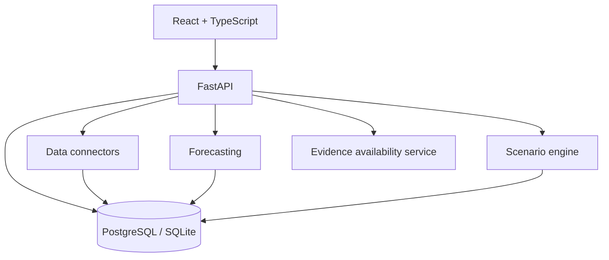

# ECONOVA architecture

React and TypeScript provide one responsive ECONOVA application shell and twelve module routes. FastAPI exposes versioned REST APIs; SQLAlchemy persists user/role data, country and indicator catalogues, observations, account-scoped scenarios and audit events. The World Bank connector writes provider-attributed observations. Forecasting uses an ARIMA candidate with holdout evaluation and a naive baseline; simulation is explicitly arithmetic sensitivity only.

The default local database is SQLite so the application starts without external infrastructure. Docker Compose switches it to PostgreSQL and requires operator-supplied credentials and a signing key. AI synthesis, document retrieval, RBI/MOSPI/IMF live connectors, complete policy/trade/global-map modules, scheduled reports and production operations are not currently implemented. World Bank series are periodically published historical data, not live feeds.
